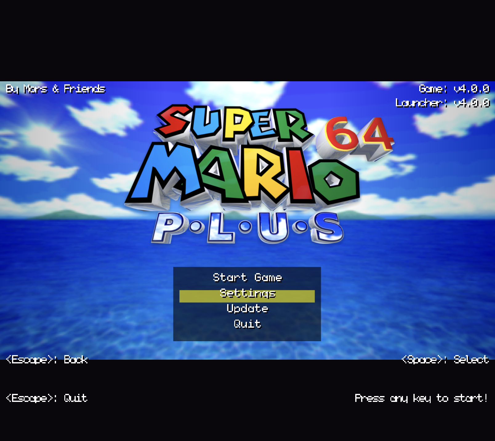

# SM64Plus Launcher — web port

The [SM64Plus launcher](https://github.com/MorsGames/sm64plus-launcher) running on a local port.

The original is a GameMaker 2022.2 app: it clones the game repository, builds it with mingw/MSYS2,
and starts the binary. A browser can't do any of that, so this port **runs the original's own code**
in the page and moves only the shell work to a small Node server on the same machine.

```bash
cd sm64plus-launcher-web
node server.js            # http://localhost:7357
```

No dependencies, no build step, Node 18+.



## What is the original

The page is one canvas and every pixel comes from the launcher's own drawing code:

| Original | Here |
| --- | --- |
| `obj_init` (disclaimer, prerequisites, ROM, build) | `boot` in `public/app.js` |
| `obj_title_menu` (logo bop, elastic scale, menu box, slide) | `titleMenu` |
| `obj_settings_menu` (tabs, option rows, descriptions) | `settings` |
| `obj_background` (void tiles, skyboxes, crossfade, messages) + `shd_curve` | `background` + `Renderer.drawBackground` |
| `obj_menu_parent` (`change_selected_option`, scrolling, shake) | `changeSelectedOption()` |
| `obj_persistent/Draw_73` (corner texts, messages) | `drawOverlayText()` |
| `scr_text_rendering.gml` (`draw_option`, `draw_text_custom`, `draw_letters`) | `Renderer` in `public/render.js` |
| `scr_types.gml` (option types, text, limits, ini) | `public/shared/options.js` |
| `scr_input.gml`, `scr_wtimer.gml` (`wait()`), `scr_wease.gml`, `scr_audio.gml` | `public/app.js`, `public/render.js` |

- **Background** — `obj_background/Draw_0.gml` draws into a surface the size of the view,
  stretches that surface over the room, and runs the result through `shd_curve`: a barrel
  distortion (`K1 = 0.15625`) that samples red, green and blue from slightly different places,
  which is where the colour fringing at the edges comes from. On top of that the Windows build
  subtracts a `c_dkgray` ramp from the outer thirds. `spr_void` is repeated over the whole surface
  and drifts sideways at 0.75 pixels a frame; its second frame, a one pixel green grid, goes on top
  at half alpha at 1.5x the drift, both with `gpu_set_tex_filter(0)`. The category crossfade, the
  message queue and the slow bob are all there too.
- **The shader is sampled, not faked** — `shd_curve` works in texture coordinates: `uv0*0.5 + 0.5`
  is a 0..1 coordinate that gets multiplied by the surface size to land on a pixel. `_curve()` does
  that per channel with bilinear filtering and clamps to the edge like `CLAMP_TO_EDGE`, which is
  what bends the corners inwards and pulls ~12% of the picture back from every corner.
- **Pictures and textures are drawn differently** — `obj_background` has one draw call for all of
  them, but the list mixes two kinds of sprite:
  - the skyboxes are 248x248 pictures, and are laid over the surface edge to edge the same way
    `draw_surface_stretched` lays that surface over the room: whole, centred by construction,
    nothing cut off. A four pixel tile can only hold the average of an entire skybox, which
    repeats every three pixels as a hard band of sky over water;
  - `spr_void` (18x24) and the inside castle texture (32x32) are textures, repeated over the whole
    surface with the drift. They repeat at their own size, which is the size their artwork is drawn
    for - `spr_void`'s two frames are a 2x2 checker of 9x12 quadrants and a one pixel green grid
    along the top and left. At `4*_size` x `3*_size` tiles (`_size = 1.125*view_hport/720`, so
    4.5 x 3.375 pixels at 720p) neither survives: the samples land on texels 2, 6, 10, 14 across
    and 3, 10, 17 down, never on texel 0, so the grid draws nothing at all and the checker
    collapses into vertical stripes. One to one needs no mip emulation, so the pattern is the
    sprite itself, and the drift is folded into the tile so it can slide forever.
- **Fonts** — two different ones, like the original:
  - every piece of body text uses `font_add_sprite(spr_font, …)`, the launcher's own 5x9 sprite
    font, rebuilt into a glyph atlas by `tools/build-assets.py`;
  - the tab titles use `draw_letters`, i.e. the **game's own** 16x16 letter textures out of
    `textures/segment2/`, with the black drop shadow, `V` replaced by `U` and texel `5000` as the
    fallback for the letters SM64 doesn't have. Those come from the game repository as soon as its
    assets have been extracted.
- **Colours** — `$0B0709` black at 62.5% alpha, `$00EFFF` yellow highlight, `c_white` `#FFFFFF`
  body text, `c_dkgray` `$404040` for the side gradients. The two black boxes go down **before** the
  tab loop, so the title, the rows and the description all sit on top of them; the highlight bar
  fades between the pulsing yellow and, on a colour option, that option's own colour. The same row
  heights, the same `Name:❓Value` option text (the `✔ ❓ ❌ ⬛ ⬜` markers only change the colour and
  take up a slot, GameMaker has no glyphs for them) and the same shakes.
- **Sound** — `snd_music`, `snd_select`, `snd_cancel`, `snd_page`, `snd_option`, `snd_denied`,
  `snd_start`, `snd_move` at the launcher's own volumes, one instance at a time.
- **Input** — the same action map (arrows and WASD, `Space`/`Enter`, `Esc`/`Backspace`, `Delete`,
  shoulder buttons for page switching), the same 20 frame long press, and the same `wait(3)`,
  `wait(4)` and `wait(8)` gates on auto repeat, which is what keeps tab switching and scrolling
  from running away.
- **Corner texts and messages** — `By Mors & Friends`, `Game: …`, `Launcher: …`, `<Escape>: Back`,
  `<Space>: Select`, `<Escape>: Quit`, `Press any key to start!`, and `display_message()` sliding in
  from the bottom left. The bottom ones are `fa_bottom` aligned, like the original.

## Controls

Keyboard, like the original: arrows/WASD move, hold to repeat, `Space` or `Enter` selects, `Esc`
goes back, `Page Up`/`Page Down` (or the gamepad shoulders) switch tabs, `Delete` removes a preset.
Clicking works as well (menu rows, option rows, the `<` `>` arrows) — the original has no mouse,
that is purely an addition.

## What still needs the local server

- clone / `git pull` / `make clean` / `make CUSTOM_TEXTURES=0|1` (`lib/build.js`), log streamed live
- the ROM upload (dropped in as `baserom.us.z64`)
- starting `build/us_pc/sm64.us`
- reading and writing `settings.ini`, `launcher_settings.ini`, `launcher_config.ini` and the presets
- serving the game's extracted `textures/` (skyboxes, segment2 letters, …)

Settings are written in the game's own format into the real save folder
(`~/Library/Application Support/SM64Plus`, `%LOCALAPPDATA%\SM64Plus`, `~/.local/share/SM64Plus`),
so the game reads them.

## Reaching the menu without a build

The original launcher only leaves the boot room once `build/us_pc/sm64.us` exists, so a fresh clone
starts at the disclaimer, asks for the ROM and builds. `?menu=1` (`http://localhost:7357/?menu=1`)
skips that and opens the main menu directly, which is handy for looking at the UI.

## Building on macOS

The game repository needs GNU Make 4 (Apple's `make` is 3.81 and silently skips `DUMMY != mkdir -p
$(ALL_DIRS)`), a working `armips` and SDL2/libpng from Homebrew:

```bash
brew install make armips sdl2 libpng
gmake -j CUSTOM_TEXTURES=1 CC=cc CXX=c++
```

Only the extracted assets (`textures/`) are needed for the launcher to look like itself — the skybox
backgrounds and the letter font — and those appear as soon as `extract_assets.py` has run.

## Layout

```
server.js              HTTP server + JSON API + static files
lib/build.js           clone / pull / make, streaming the log
lib/paths.js           where the repository, builds and saves live
public/render.js       canvas port of the drawing code, the background shader and the easings
public/app.js          the objects, ported one by one
public/shared/         options.js (scr_types.gml), ini.js, dik.js (DirectInput scan codes)
public/assets/         logo, void tiles, placeholder, font atlas, sounds (generated)
tools/build-assets.py  rebuilds public/assets from the GameMaker project
```

## Rebuilding the assets

```bash
git clone https://github.com/MorsGames/sm64plus-launcher.git
python3 -m pip install fonttools pillow
python3 tools/build-assets.py
```

## Environment variables

| variable | meaning |
| --- | --- |
| `PORT` | port to listen on (default `7357`) |
| `SM64PLUS_HOME` | where the game repository is cloned (default `~/.sm64plus-launcher-web`) |
| `SM64PLUS_SAVE_DIR` | override the save folder |
| `SM64PLUS_REPO_DIR` | use an existing checkout instead of cloning |

## The game still needs a ROM

The build needs a US Super Mario 64 ROM in Z64 (big endian) format; the launcher asks for it in the
browser and drops it into the repository. Nothing copyrighted is bundled here.

`window.__launcher` exposes `{ app, boot, titleMenu, settings, background, renderer, input }` in the
console for poking at the port.